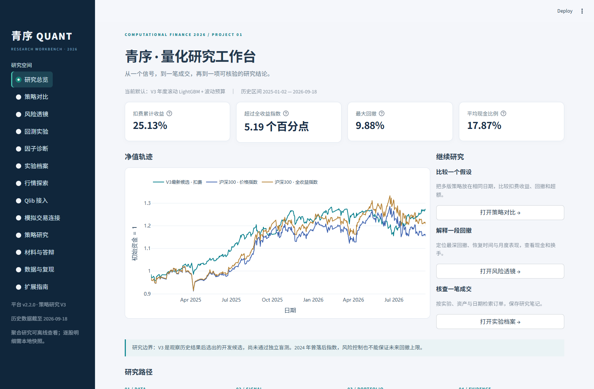

# 青序 · 量化研究工作台

**平台 v2.6.0，保留年度 LightGBM 主线及两条独立 Project 2 复现路线，增加持续数据维护、跨年模型缓存和模拟服务自动恢复。** 本地运行的 Python 研究平台：从行情、因子和策略，到模拟执行、成交核对、风险解释与实验记录。

**v2.5 历史模拟接入验收（2026-10-20）：5 个独立专用账户，各 20 万元初始模拟资金，资金／持仓／成交查询已通过；当时零委托、零成交，尚无前瞻收益结论。** 五个候选是 V3、CogAlpha 白箱、两条 RSRS 和沪深 300 ETF 对照。各策略只有通过最新数据、执行适配和账户检查才可启用，开户成功不等于策略已经开始交易。手机账户互通未验证。[使用与状态说明](docs/THS_CONNECTION.md) · [官方接口来源及限制](docs/THS_SIMULATION_RESEARCH.md)

历史 [v2.5 验收记录](evidence/simulation_auto/acceptance.json)包含 216 项去重通过测试、桌面页面交互、只读账户查询及私有记录迁移核验；实际委托撮合和非空成交回报仍待首个交易日验证。

**v2.6 持续运行：** 17:05 后准备最新完整交易日数据，错过晚间更新可在启动或次晨续跑；行情按批保存，财务与行业按实际观测时间保存版本，V3 按执行年度使用此前三年的已成熟标签训练并缓存。后台更新与执行心跳分开，新增 Windows 登录及定时启动安装器。当前真实参考数据初扫进行中；[v2.6 验收记录预定位置](evidence/simulation_continuous/acceptance.json)待生成，不能据此声称新版已全部验收。操作、恢复和数据边界见[持续模拟运行说明](docs/CONTINUOUS_SIMULATION_V260.md)。

Project 2 小组：12412408 胡博文、12410819 谢明飞、12410436 王天希。正式课程要求逐页对应见[要求与交付矩阵](docs/PROJECT2_REQUIREMENTS_MATRIX.md)，数据身份、离线评价、模型预算及命令见[Project 2 复现说明](docs/PROJECT2_REPRODUCIBILITY.md)。

**本轮研究状态（2026-10-19）：RSRS 的198组正式实验完成；CogAlpha 的3次提案重复、90组投资实验及113项公开证据文件已生成，90组账本全部通过。** CogAlpha的16页报告、16页Beamer、8页讲稿PDF及16页可编辑PPTX均完成编译/结构核验和全页视觉检查；实际浏览器交互、四件材料下载入口及报告下载已经验收，正式发布审计的六个检查部分全部通过。不把模型连通、质量通过数或账本一致性当作策略有效的证明，也未提交 Blackboard。

| 独立路线 | 平台入口 | 本轮范围与边界 |
| --- | --- | --- |
| RSRS 研报复现 | 研报复现 · P2 | 原图/表对照、公式与执行核验、单项差异诊断；原策略、固定75%仓位与15%波动目标同口径比较。 |
| CogAlpha 论文复现 | 论文复现 · CogAlpha | 原例公式、因子谱系、真实模型提案及同候选预算的进化/新提案对照；当前为受限机制复现，不是原表精确数值复现。 |

两条路线分别保存配置、证据、报告、Beamer、可编辑PPTX与讲稿，不合并研究结论，也不替换原V3默认策略。两者均为已观察历史的回溯研究；CogAlpha另有静态股票池与模型知识污染风险。页面不自动发起外部模型请求。CogAlpha提案阶段使用一个共享缓存与账本，50元是整项研究的费用上限，不是必须花完的金额；离线 `--stage evaluate` 不需要 API。

CogAlpha离线评价可从保存的已接受公式重建因子缓存，并按固定参数重新拟合；API别名不是不可变模型版本，再次实时提案不能保证得到同结果。其沪深300基准是价格指数，与股票复权收益不是完全同口径的全收益比较。公开模型元数据不含拟合系数、截距或模型权重。论文文件哈希的65字符转录笔误由[独立勘误](configs/project2_cogalpha_source_erratum.json)纠正，冻结研究配置保留原字节身份。

三轮挖掘保留全部231槽位：197通过质量检查、34拒绝；236提案尝试加1次连通检查，共237次成功调用，保守估费1.312712元、未知预留0。本次离线评价使用保存公式完成，没有新增API调用。公开[审计器](scripts/audit_project2_cogalpha.py)提供 `--self-test` 和完成后的 `--final`；复跑示例默认写入独立 `runs/reproduction_cogalpha/`，不覆盖发布证据。

**CogAlpha的预设主比较没有支持“进化更优”。** 在2025-01-02至2026-09-18、指定成本、LightGBM的三次重复中，evolved49相对同槽位预算fresh49的Rank IC全部下降，平均差值为−0.006788；年化收益差值有正有负，平均为−0.78个百分点。训练期去冗余扩展在2/3次重复中提高Rank IC，但年化收益仅1/3次提高，不能据此替换原主线。全部失败和未改善结果保留，详见[18项固定比较](evidence/project2_cogalpha/comparison.csv)和[完整90组绩效](evidence/project2_cogalpha/performance.csv)；三次重复不足以证明普遍优劣。

## 保留的 v2.3.0 平台研究

v2.3.0借鉴 CogAlpha 1.4.0 的研究流程及 1.4.1 的启动修复，没有替换原平台。当时新增28个独立因子身份（12个经济因子＋16个DSL公式）、训练期筛选、年度白箱排名/Ridge、固定目标融合、大模型可切换研究接口、持仓贡献解释、行业损益归因、严格成交情景、观察计划冻结及历史指数权重导入。[完整研发与复现说明](docs/RESEARCH_LAB_V230.md) · [1.4.1实际差异](docs/COGALPHA_141_REVIEW.md) · [新功能演示稿](docs/DEMO_SCRIPT_V230.md)

在已有1000股、1,656,599行Tushare快照上重跑，2025-01-02至2026-09-18：

| 路线 | 累计扣费收益 | 年化夏普 | 最大回撤 |
| --- | ---: | ---: | ---: |
| 原主线 LightGBM（继续默认） | 25.13% | 1.255 | 9.88% |
| 主线＋白箱排名目标各50% | 20.54% | 0.977 | 11.99% |
| 年度白箱 Ridge | 18.37% | 0.759 | 15.19% |
| 白箱排名 | 15.63% | 0.657 | 15.08% |
| 固定经济白箱 | 13.90% | 0.673 | 14.74% |

同期沪深300价格指数14.55%、全收益指数19.94%。辅助候选没有超过主线；全部候选及失败比较保留。本区间已被观察，结果是历史开发比较。v2.3.0当时使用缓存真实数据，没有新拉行情、没有实际调用语言模型，也没有真实历史指数增强或新交易日前向成绩。这是该历史版本的事实；本轮CogAlpha正式研究的模型调用与预算单独记录，不能沿用这句旧版说明。原因子研发接口由用户主动运行；指数增强需要完整历史权重。

v2.2.1新增醒目的年化夏普比率、可调无风险利率与60日滚动夏普。默认0%假设下V3为1.255，同期沪深300全收益指数为0.736；[公式、复算和答辩说明](docs/SHARPE_RATIO.md)。V4报告已包含默认值，PDF保留v2.2.0发布时的验收记录。

v2.2.2在“回测实验”补齐V2/V3的年化夏普结果卡，V1也统一中文标签；显示当前结果实际使用的无风险利率与年化参数。



## 这一版可以做什么

| 页面 | 可以实际完成的操作 |
| --- | --- |
| 研究总览 | 查看最新研究结果与边界，直接进入比较、风险、实验和材料 |
| 研报复现 · P2 | 切换指数、时期与成本，原图/表对照、198组正式RSRS方案、波动目标/固定仓位比较、差异诊断、独立参数回放与材料下载 |
| 论文复现 · CogAlpha | 独立查看协议差异、候选谱系/质量、同预算预测与投资实验、实际模型预算和独立材料；缺结果时明确提示未完成 |
| 策略对比 | 同时选择最多5个V2/V3/V4版本，选择日期和价格/全收益基准，下载完整分析包 |
| 风险透镜 | 月收益、回撤事件与恢复、60日滚动风险、现金/换手/费用，静态现金比例与通胀假设情景 |
| 回测实验 | 切换V1/V2/V3及V4辅助候选，修改参数重跑；资金账本与策略收益验收分别判断 |
| 因子研发 | 校验白名单公式、保存研究方案、运行独立实验、比较因子IC和候选收益、解释持仓、切换模型接口 |
| 策略验证 | 成交压力、逐股/行业损益、冻结观察计划、目标融合、历史指数权重CSV校验与独立约束回测 |
| 因子诊断 | 12个研究因子统一入口，日期筛选、IC/Rank IC、分组与覆盖；保留原三因子自由诊断 |
| 实验档案 | 搜索本地实验，检索持仓与订单、解释未成交、下载结果、保存本地笔记 |
| 行情探索 | 股票搜索、复权/原始K线、均线、成交量、缺失交易日与CSV导出 |
| Qlib 接入 | 正式pyqlib表达式引擎、8个表达式独立核对、官方Alpha158浏览与诊断、隔离进程重跑 |
| 模拟交易连接 | 官方专用模拟账户查询、自动执行开关、服务心跳、持续数据准备、持仓／成交／持久委托账本、共同区间收益和Sharpe；保留成交CSV核对与历史权重导出 |
| 材料与答辩 | 报告、Beamer、可编辑PPTX、完整逐页讲稿与演示操作卡 |

**Qlib是真实接入，当前范围是数据与因子研究桥。** pyqlib 0.9.7在独立环境调用；20股、33,754条行情、1,690个交易日，8项表达式逐项核对，官方Alpha158的158项均产生有效输出。没有以此重新训练或替换V3投资策略。[接入说明](docs/QLIB_INTEGRATION.md)

**同花顺专用模拟连接与历史文件桥分别运行。** 专用适配器连接官方 SkillHub 模拟服务，自动执行只处理模拟账户；普通手机已有账户的互通尚未验证，SuperMind 用户环境也未接入。交易日 09:35–09:45 执行；数据准备以 17:05 后最新完整交易日为目标，启动、晚间和晨间均可补齐，失败按持久退避计划重试。数据工作在线程中进行，服务每 30 秒循环检查心跳与执行状态。电脑需开机、登录、保持唤醒并联网。未知委托会暂停相关执行，不自动撤单或重发。[完整操作步骤](docs/THS_CONNECTION.md)

v2.5 历史阶段曾追加至2026-10-20（新增16个交易日、15,295行），当时财务与行业冻结在2026-09-18。v2.6 增加披露事件检查、固定1000股池的月度财务扫描和每周行业版本维护；新观测不会回填旧日特征，历史研究快照保持不变。它仍受固定股票池和参考数据可得性限制，不是原历史策略的完全等价延伸，也不承诺当日公告即时全覆盖。RSRS以指数形成信号、以510300.SH ETF执行，存在跟踪、分红、成本与整手差异。前瞻收益只使用接入后的账户观察，尚无经过验证的前瞻收益结论；日度Sharpe至少要求20个完整区间。

旧文件桥仍可导入成交CSV、核对逐笔金额并保存回执。历史复权单位不当作委托股数，成交现金流不冒充账户收益；合成样例与外部模拟成交分开标注。

## 打开平台

本机双击 `launch.cmd`。启动器显示版本、目录与实际URL，优先8501；端口被占用时选择可用端口，健康检查后打开浏览器。新电脑安装Python3.12/3.13：

```powershell
py -3.12 -m venv .venv
.venv/Scripts/python.exe -m pip install -r requirements-research-lock.txt
.venv/Scripts/python.exe -m pip install -e ".[dev,research]"
.venv/Scripts/python.exe -m pytest -q -p no:cacheprovider
.venv/Scripts/python.exe -m cfquant.cli run --config configs/demo.yaml
.venv/Scripts/python.exe -m streamlit run app.py
```

无Token可看真实公开聚合结果、12因子诊断、Qlib核验结果，运行合成样本与模拟成交文件校验。真实模型重跑、行情与逐股成交需要本地私有快照。Qlib重跑另需独立环境；不修改已验证的主环境依赖。

首次安装默认暂停，需要在页面明确开启。平台启动器会按已保存的“允许”状态恢复隐藏工作进程，独占锁阻止重复实例；也可安装 `scripts/install_simulation_autostart.ps1`，在当前用户登录、08:55 和17:10启动服务，并每分钟检查服务是否缺席，运行中忽略重复触发。错过触发时机可补启动。安装器不开户、不改变执行开关；环境路径和安装命令见[持续运行说明](docs/CONTINUOUS_SIMULATION_V260.md)。页面开关本身不启动进程，运行状态以心跳为准。手动运行可用 `python scripts/run_simulation_service.py --root . --watch`。Tushare凭据仅在本机 `D:/CodexData/private/qingxu/tushare_token.txt` 读取。服务、账户和订单保存在忽略目录 `runs/simulation_auto/`，不进入公开仓库；界面的“刷新账户”只查询，不发送委托。

P2两个页面同样可无Token浏览已发布证据；RSRS本地重放需要`data/private/project2_rsrs`，CogAlpha完整离线评价需要原私有快照和完整提案记录，因子缓存可由保存公式重建。公开仓库不含原始授权行情与密钥。P2正式CLI是`scripts/run_project2_rsrs.py`、`scripts/run_project2_cogalpha.py`；历史`projects/project2_rsrs/`保留作旧实现核对，不能把其中预研说明当成本轮正式协议。

日期筛选是原有持仓路径的切片，包含所选首日收益；“回测实验”才是在指定日期重新启动。现金比例工具是静态分配的算术情景，不再平衡，也不重新模拟资金规模对费用和容量的影响。

## 最新提交材料

- Project 2 · RSRS：[报告](reports/project2_rsrs/CF2026_Project2_Report.pdf)、[Beamer](reports/project2_rsrs/CF2026_Project2_Beamer.pdf)、[可编辑PPTX](reports/project2_rsrs/CF2026_Project2_Presentation.pptx)、[讲稿](reports/project2_rsrs/CF2026_Project2_Speaker_Script.pdf)；[逐页讲稿](docs/PROJECT2_PRESENTATION_SCRIPT.md)与[正式证据](evidence/project2_rsrs)。
- Project 2 · CogAlpha：[16页报告](reports/project2_cogalpha/CF2026_Project2_CogAlpha_Report.pdf)、[16页Beamer](reports/project2_cogalpha/CF2026_Project2_CogAlpha_Beamer.pdf)、[16页可编辑PPTX](reports/project2_cogalpha/CF2026_Project2_CogAlpha_Presentation.pptx)、[8页讲稿](reports/project2_cogalpha/CF2026_Project2_CogAlpha_Speaker_Script.pdf)；[独立证据](evidence/project2_cogalpha)已完成，四件材料全部完成编译/结构核验和全页视觉检查；浏览器验收已通过，正式发布审计六部分全部通过。
- PPTX可以直接编辑；从源码重建PPTX另需artifact工具运行环境。报告、Beamer、讲稿的TeX及配图可在XeLaTeX/CTeX环境中独立编译，详见[P2材料复现条件](docs/PROJECT2_REPRODUCIBILITY.md)。
- 以下v2.3.0及更早材料为保留的历史平台交付：
- v2.3.0：[最终报告](reports/platform_v230/CF2026_V230_Final_Report.pdf)、[Beamer](reports/platform_v230/CF2026_V230_Beamer.pdf)、[可编辑PPTX](reports/platform_v230/CF2026_V230_Presentation.pptx)、[演讲稿](reports/platform_v230/CF2026_V230_Speaker_Script.pdf)；均保留源码。
- [v2.3.0验收记录](evidence/ui_v230)、[真实辅助候选完整证据](evidence/research_v4)、[可读逐页讲稿](docs/PRESENTATION_SCRIPT_V230.md)。
- 以下为保留的旧版材料：
- [10页报告](reports/platform_v4/CF2026_V4_Final_Report.pdf)与[源码](reports/platform_v4/final_report.tex)
- [20页LaTeX Beamer](reports/platform_v4/CF2026_V4_Beamer.pdf)、[可编辑PowerPoint](reports/platform_v4/CF2026_V4_Presentation.pptx)
- [可打印逐页讲稿](reports/platform_v4/CF2026_V4_Speaker_Script.pdf)与[可编辑讲稿](docs/PRESENTATION_SCRIPT_V4.md)，18页正文约19分钟＋2页备份
- [课程逐项验收](docs/ACCEPTANCE_V4.md)、[复现步骤](docs/REPRODUCE_V4.md)、[本轮验证证据](evidence/platform_v4)
- [V3历史材料](docs/README_V3_ARCHIVE.md)、[12因子卡](docs/FACTOR_CARDS_V2.md)、[基准来源](docs/BENCHMARK_METHOD_SOURCES_V3.md)

## 保留的V3策略与边界

2025-01-02至2026-09-18：扣费累计收益25.13%、年化14.51%、最大回撤9.88%；同期沪深300价格指数14.55%、全收益指数19.94%。双倍费用收益22.48%；2023起连续运行44.09%、最大回撤19.70%。

**当前候选是在查看历史复核后选出的开发候选，尚非独立盲测成功。** 2024年曾落后指数。完整8个V3候选、失败预选、5个V2模型和V1失败结果均保留；本轮工具增强没有重新挑选历史赢家，也不保证未来收益。

原始快照固定2019年末1000只主板股票，价格2019-10-08至2026-09-18，共1,656,599条记录。12个经济因子的标准化及中性化表示构成24输入；模型每年使用此前3年已实现标签重训。50股、20日调仓、20名缓冲、单股4%/行业25%目标、20%波动预算、95%最大股票仓位、指数趋势折减，允许现金，不用杠杆。

研究用连续复权单位，未完整模拟整手、结算、分红现金、历史税费和盘口；固定池与厂商数据修订限制泛化。目标权重会漂移，风险预算不能保证回撤上限。

## 验证与维护

P2验收分开记录：当前自动测试[去重汇总](evidence/project2_release/test_acceptance.json)为462项全部通过、0项未解决跳过；包含主研究环境及独立Qlib环境的实际运行，不是一次全套0跳过。公开审计器的10项合成自检另计，不代替正式审计。RSRS的198组主运行及独立旧实现核验见`evidence/project2_rsrs/validation.json`；执行器扩展后198组重放一致，浏览器已验收，记录分别见`release_engine_equivalence.json`和`ui_acceptance.json`。CogAlpha的90组账本通过、113项清单文件哈希核对通过；四件材料的视觉验收见对应报告目录的`visual_qa.json`及`pptx_validation.json`，实际浏览器交互、四件材料下载入口及报告下载已经验收，正式发布审计的六个检查部分全部通过。P2专项测试、公开证据哈希核验命令见[复现说明](docs/PROJECT2_REPRODUCIBILITY.md)。以下数量是历史版本记录，不代表本轮P2测试总数。

v2.3.0最终269项测试通过、1项可选Qlib测试跳过，完整记录见`evidence/ui_v230/tests.xml`；真实辅助研究10条基础账本、3条严格情景账本与10份资金归因全部核对通过，28个因子身份无重名，训练折标签退出早于形成日，公开证据哈希通过。严格情景仍使用连续复权单位及原始等价整手，未完整模拟企业行动、托管和清算。[复核命令](scripts/validate_research_v4.py)不修改原实验。[本版验收与使用边界](docs/ACCEPTANCE_V230.md)

历史v2.2.2主环境104项测试通过，1项可选Qlib引擎测试因未在主环境安装Qlib而跳过；该引擎测试在独立Qlib环境的5项专项测试中实际通过。v2.2.1增加非零无风险利率手算例及界面重算测试，证据见`evidence/sharpe_v221`；V4原始材料保留发布时102项通过的记录。保留21个V3账本检查与独立环境复算。新分析模块重算V3指标与原证据一致，测试覆盖首日损失、内部缺日、月复利、未恢复回撤、CSV编码/金额/重复、笔记与回执安全保存。

- `analytics.py`：共享诊断和分析计算；`engine.py`：成交与账本。
- `strategies.py`：策略版本与重跑；`experiment_catalog.py`：实验索引与明细读取。
- `qlib_bridge.py`：外部表达式数据适配；`simulation_bridge.py`：保留的模拟成交文件协议。
- `ths_simulation.py`：官方专用模拟服务适配；`simulation_execution.py`：持久委托、去重与账户风控；`simulation_service.py`：前向执行调度。
- `simulation_signals.py`：指数信号到ETF的执行映射；`equity_forward.py`／`equity_simulation.py`：股票特征、目标与受约束的委托规划。
- `simulation_schedule.py`／`simulation_refresh.py`：持久刷新计划与后台工作；`equity_data_store.py`／`equity_reference.py`：行情检查点及参考数据观测版本；`equity_continuous.py`／`equity_training.py`：持续特征准备、年度标签截止和模型缓存。
- `ui_*.py`：界面模块；主应用负责导航，公开证据与私有原始数据分别加载。

因已复现NumExpr在原Anaconda环境的数值异常，保留禁用该可选计算路径的既有策略，详情见[数值审计](docs/NUMERICAL_AUDIT.md)。真实行情、凭据、逐股模型分数、实验笔记与模拟回执留在本地，不进入公开Git。第三方依赖保留各自许可；不声称完整实现Qlib模型或外部交易引擎。
